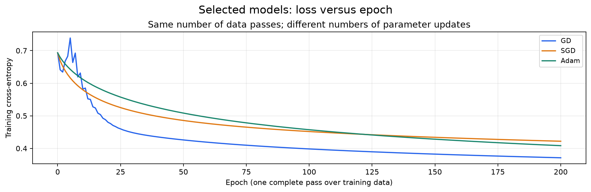

# MLT Assignment 3: Optimization algorithms

**Hazem Daw | Group J4132**  
Machine Learning Technologies, ITMO University, 2026

Logistic regression on the biological response dataset, comparing gradient descent (GD), stochastic gradient descent (SGD) and Adam. The model and optimization algorithms use NumPy; plots use Matplotlib.

**[Open the notebook](Task_3_Hazem_Daw_Group_J4132.ipynb)** for the calculations, learning curves and conclusions. All outputs are saved.

## Data and method

The dataset contains 3,751 molecules, 1,776 descriptors and a binary target, `Activity`. A stratified split with seed 42 assigns 2,813 rows to training (75%) and 938 to testing (25%). The descriptors are centered using training means.

Five learning rates are tested for each optimizer: **0.0001, 0.001, 0.01, 0.1 and 1.0**. Each run uses 200 epochs. GD uses the full fitting set per update, SGD uses one example, and Adam uses batches of 64.

Learning rates are selected by final validation cross-entropy using a split within the training portion. The selected models are then trained on the full 75% training set and evaluated on the test set. No regularization or early stopping is used.

## Results

| Optimizer | Learning rate | Train accuracy | Test accuracy | Test cross-entropy |
|---|---:|---:|---:|---:|
| GD | 1.0 | 83.90% | 75.91% | 0.546764 |
| SGD | 0.0001 | 81.37% | 76.01% | 0.519764 |
| Adam | 0.0001 | 82.23% | 75.80% | 0.506201 |

The majority-class baseline gives 54.26% accuracy. SGD has the highest test accuracy, but the spread across the three models is only two correct predictions out of 938. Adam has the lowest test cross-entropy.

Small learning rates slow down GD within the 200-epoch budget. Larger rates for SGD and Adam often improve the training fit while worsening validation loss. The best rate depends on the optimizer and the evaluation criterion.



An epoch is one pass through the training data. The notebook also plots loss against the actual number of parameter updates and includes curves for all 15 learning-rate experiments.

## Running the analysis

Clone or download the repository and install the dependencies:

```bash
python -m pip install -r requirements.txt
```

Open the notebook in Jupyter and select **Restart Kernel and Run All**. Keep `bioresponse.csv`, `figures/` and `results/` in the same folder as the notebook. The saved run used Python 3.11, NumPy 2.4.6 and Matplotlib 3.11.2.

NumPy handles data loading, preprocessing, training and evaluation. Matplotlib is used only for visualization. The implementation includes finite-difference gradient checks and checks of the SGD and Adam updates.

## Files

- [Notebook](Task_3_Hazem_Daw_Group_J4132.ipynb): implementation, experiments and discussion.
- [Dataset](bioresponse.csv): the CSV provided with the assignment.
- [Figures](figures/): learning curves and learning-rate comparisons.
- [Results](results/): experiment tables, loss histories and fitted parameters.

## References

MLT 2026 Homework 3; the course notebook *Logistic Regression as a Neural Network*; Lecture 6-1, *Optimization Algorithms*; and Lecture 6-2, *MLP and backpropagation*.
